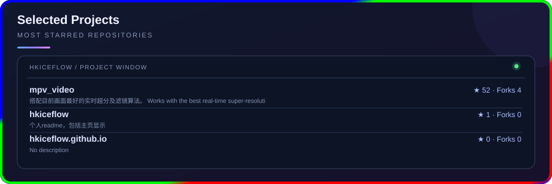
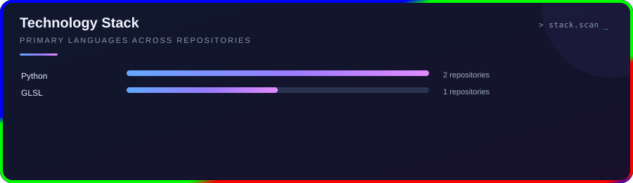
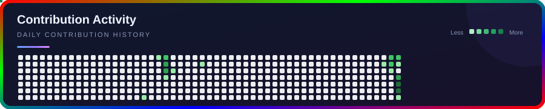

  

<table width="100%">
<tr>
<td width="64%" valign="middle" align="center">

人员简报 · hkiceflow

<h1>iceflow</h1>
<h2>:wave: : HI！ This's ICEFLOW</h2>

Obviously, I am Chinese. :sunglasses:

VR软硬件开发工程师、测试工程师、交互设计师、产品经理、OPC、CEO、集团顾问、剪辑师、调色师【其余可查看下方列表】 ;
 MPV（mpv-net）、Stablediffusion（sd项目已弃用）开发者。

<strong>● Building and sharing work in public</strong>

 
 </code></a>

![Modern C++ template][github-sub-title:img]

) 

 
 

[github-sub-title:img]: https://readme-typing-svg.herokuapp.com?font=Segoe+Script&center=true&lines=hkiceflow.

<h3 align="left">Connect with me:</h3>

 
 

 

Buildings that were once located at Florida State University, Florida, USA

</td>
<td width="36%" valign="middle" align="center">

</td>
</tr>
</table>

  

| **常用**                | **软件及技术**                                      |
|-------------------------|-----------------------------------------------------|
| **语言/集成开发环境**   |      &nbsp;     |
| **工作/学习 平台/方式** |  &nbsp;               |
| **辅助类工具**          | &nbsp;                |
| **技能/证书**           |      |
| **当前软件开发**        | |
| **兴趣/爱好**           |                       |

<h2>团队快速评估</h2>

  

<h2>Github 核心成果概览</h2>

  

<code>176 contributions</code> · <code>2 day streak</code>

<h2>精选项目</h2>

  

<h2>技术工具包 · 我未上传 code 信息，直接更新 Releases</h2>

  

<table width="100%">
<tr>
<td width="20%" align="center"><strong>GLSL</strong> 99% of public code</td>
<td width="20%" align="center"><strong>Lua</strong> 0% of public code</td>
<td width="20%" align="center"><strong>Python</strong> 0% of public code</td>
<td width="20%" align="center"><strong>C</strong> 0% of public code</td>
<td width="20%" align="center"><strong>Batchfile</strong> 0% of public code</td>
</tr>
</table>

<h2>Consistency signal</h2>

  

## 🏆 GitHub Trophies

  

<table width="100%">
<tr>
<td width="62%" valign="middle"><h2>期待与你共同打造下一个作品</h2>
期待与有深度的团队、有抱负的产品和有实际价值的工程项目合作。
</td>
<td width="38%" valign="middle" align="right">
 
 
 

</td>
</tr>
</table>
